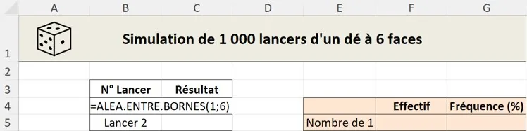
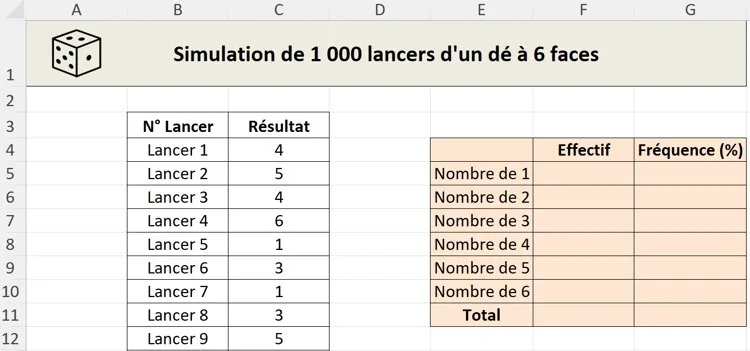
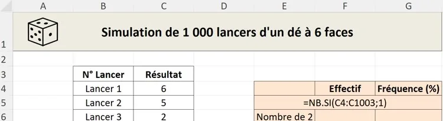

Lorsqu'il joue aux dés, Kevin choisit toujours le 4 car ce numéro lui porte chance. Il trouve que ce numéro sort plus souvent que les autres.

::: problematique
Est-il possible qu'un numéro tombe plus souvent qu'un autre ?
:::

### Partie A — Simulation de 1 000 lancers de dé

1. Combien de faces possède un dé ?

2. En théorie, quelle est la probabilité que Kevin obtienne un 4 lorsqu'il lance le dé ?

3. On souhaite réaliser une simulation de 1 000 lancers de dé à l'aide d'un tableur.

   Ouvrir le fichier « Lancers de dé » dans un tableur.

   ::: fichier fichiers/lancers-dun-de-tableur.xlsx
   :::

   Dans le fichier, sélectionner les deux premiers lancers, puis cliquer sur la croix noire en bas à droite de la sélection et étendre la colonne jusqu'à 1 000 lancers.

   

   **Remarque :** la croix noire s'appelle la **poignée de recopie**. Elle est très utile.

4. Dans la case **C4**, on veut simuler le résultat d'un lancer de dé à 6 faces. On utilise la formule **=ALEA.ENTRE.BORNES(1;6)**. Cette fonction génère un nombre entier aléatoire entre 1 et 6.

   

5. Étendre cette formule aux 1 000 lancers à l'aide de la poignée de recopie.

   

### Partie B — Dénombrement des résultats

Avec cette simulation, on cherche la fréquence de chaque numéro, afin de voir si certains sortent plus souvent que d'autres.

1. Dans la cellule **F5**, on veut obtenir le nombre de fois que le résultat « 1 » est sorti dans la simulation. On utilise la formule **=NB.SI(C4:C1003;1)**, qui compte le nombre de fois que le résultat 1 apparaît dans les cellules **C4** à **C1003**.

   

   **Remarque :** les résultats sont différents à chaque simulation : appuyer sur **F9** pour le vérifier.

2. Appliquer la même démarche pour compter les autres issues possibles.

3. Calculer la fréquence de chaque résultat.

4. Actualiser plusieurs fois le fichier à l'aide de la touche F9. Le numéro « 4 » sort-il plus souvent que les autres ?
