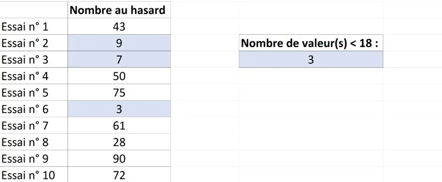
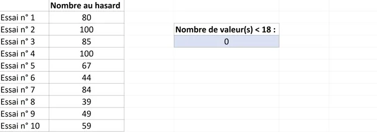
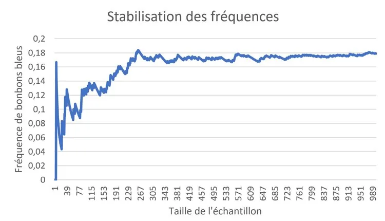

**Définition**

Si l'on réalise plusieurs échantillons de taille $n$, on appelle **étendue des fréquences** la différence entre la plus grande et la plus petite des fréquences observées.

Cette étendue des fréquences a tendance à se rapprocher de 0 quand $n$ devient grand : la fréquence observée se rapproche alors de la **probabilité**.

**Exemple**

Dans un paquet de bonbons, la probabilité de piocher un bonbon bleu est de 18 %. On simule 10 tirages avec un tableur (voir la fiche méthode « Réaliser une simulation avec un tableur »).

La fréquence de bonbons bleus dans cet échantillon est $f_{\text{bleu}}= \dfrac{3}{10}=30~\%$ : l'écart avec la probabilité de piocher un bonbon bleu (18 %) est important.

Si on relance la simulation :

Cette fois-ci, la fréquence de bonbons bleus obtenue est de 0 %, ce qui est encore différent de la probabilité de piocher un bonbon bleu (toujours 18 %).

Le graphique ci-dessous montre que plus on pioche de bonbons, plus la fréquence observée de bonbons bleus se rapproche de la probabilité attendue (18 %).

