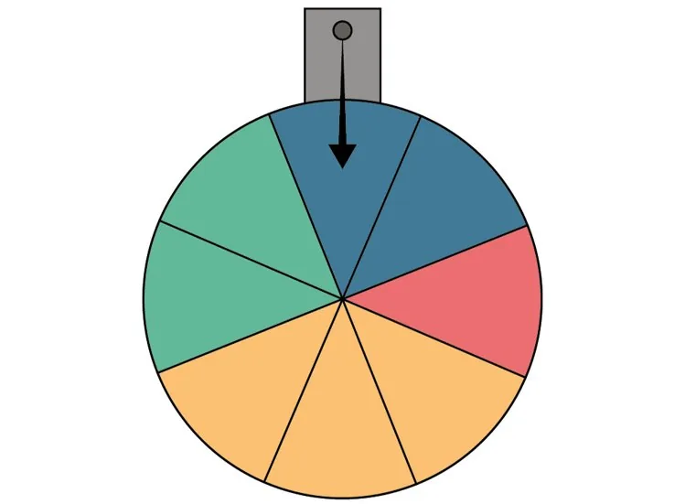

On fait tourner la roue suivante.

1. Calculer la probabilité que la roue s'arrête sur un secteur jaune.

2. Calculer la probabilité que la roue s'arrête sur un secteur rouge.

3. Calculer la probabilité que la roue ne s'arrête pas sur un secteur vert.
