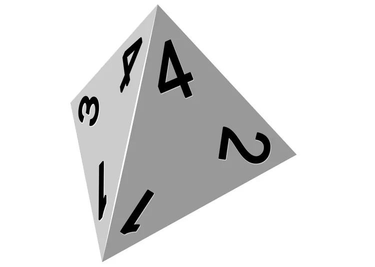

On lance deux dés à 4 faces et on note le résultat de chaque dé (on retient le chiffre écrit à l'endroit, près du sommet : 4 sur l'image).

1. Dans le tableau ci-dessous, sont notés :

   - dans la première colonne les résultats possibles du premier dé ;
   - dans la première ligne les résultats possibles du second dé.

   Compléter le tableau des issues.

   | Dé 1 / Dé 2 | 1 | 2 | 3 | 4 |
   |---|---|---|---|---|
   | 1 | 1-1 | 1-2 | ... | ... |
   | 2 | 2-1 | ... | ... | ... |
   | 3 | ... | ... | ... | ... |
   | 4 | ... | ... | ... | 4-4 |

2. Calculer la probabilité d'obtenir un double.
