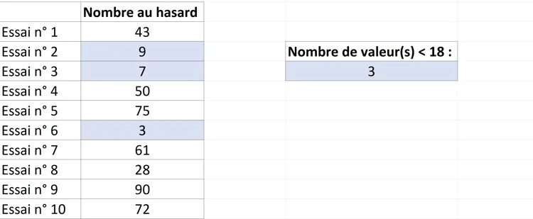

**Principe**

Pour réaliser la **simulation** d'une expérience aléatoire, on peut utiliser un tableur. Deux fonctions sont très utiles :

- la fonction **=ALEA.ENTRE.BORNES(min;max)** renvoie un nombre entier choisi au hasard entre la borne inférieure et la borne supérieure ;
- la fonction **=NB.SI(plage;critère)** compte le nombre de cellules d'une plage qui vérifient un critère donné.

Pour en savoir plus : [ALEA.ENTRE.BORNES](#outils-tableur/o-tab-alea) et [NB.SI](#outils-tableur/o-tab-nbsi) dans la boîte à outils.

**Exemple**

Dans un paquet de bonbons, la probabilité de piocher un bonbon bleu est de 18 %.

Pour simuler cette expérience, on tire un nombre entier au hasard entre 0 et 99 avec **=ALEA.ENTRE.BORNES(0;99)** : on convient que les 18 nombres de 0 à 17 correspondent à un bonbon bleu. La formule **=NB.SI(plage;« <18 »)** compte alors le nombre de bonbons bleus piochés.

Dans cette simulation, sur 10 essais, 3 bonbons bleus ont été piochés.
