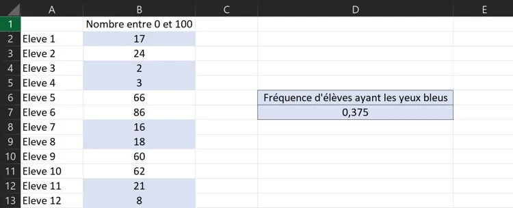

Jaimar a lu dans un article que 22 % des Français ont les yeux bleus. Pourtant, dans sa classe de 24 élèves, seuls 3 élèves ont les yeux bleus. Elle pense que les statistiques sont fausses.

::: problematique
Est-il possible d'avoir si peu de personnes avec des yeux bleus dans une classe alors que 22 % des Français ont les yeux bleus ?
:::

1.
   1. On choisit un élève dans la classe. Calculer la probabilité qu'il ait les yeux bleus.

   2. On forme une classe en prenant 24 Français au hasard. En supposant que la fréquence observée soit égale à la probabilité, combien devrait-on observer d'élèves avec les yeux bleus ?

2. À l'aide d'un tableur, comment pourrait-on savoir s'il est possible d'avoir une telle distribution ?

3. Ouvrir le fichier tableur ci-dessous.

   ::: fichier fichiers/eval2.xlsx
   :::

   Dans ce fichier, on a obtenu :

   

   1. Quelle fonction a été utilisée en **B2** afin de simuler un nombre entier entre 0 et 100 ?

   2. Compléter dans le fichier tableur la cellule **D7** pour calculer la fréquence d'élèves ayant les yeux bleus dans la simulation.

4. Actualiser plusieurs fois la simulation à l'aide de la touche F9. Est-il possible d'observer une fréquence d'élèves aux yeux bleus égale ou inférieure à celle observée dans la classe de Jaimar ?

5. Rédiger un message à Jaimar pour lui expliquer la réponse à la problématique.
