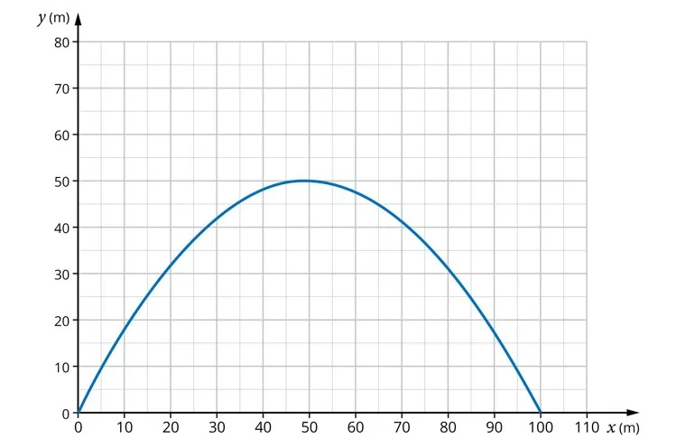

On lance une balle à partir du sol grâce à un dispositif muni d'un ressort. La vitesse initiale est de 35 m/s avec un angle d'inclinaison par rapport au sol de 63°.

Le graphe ci-dessous représente la hauteur atteinte par la balle en fonction de la distance parcourue horizontalement.

1.
   1. Quelle est la forme de la représentation graphique ?

   2. À quel type de fonction correspond-elle ?

2. À quelle distance horizontale la balle atteint-elle sa hauteur maximale ?
3. Quelle est la portée de la balle ? On appelle portée la distance horizontale finale parcourue par la balle.

4. Déterminer graphiquement la hauteur atteinte pour une distance horizontale égale à 80 m.

5. Déterminer graphiquement les valeurs de $x$ pour lesquelles la hauteur atteinte est égale à 10 m.
