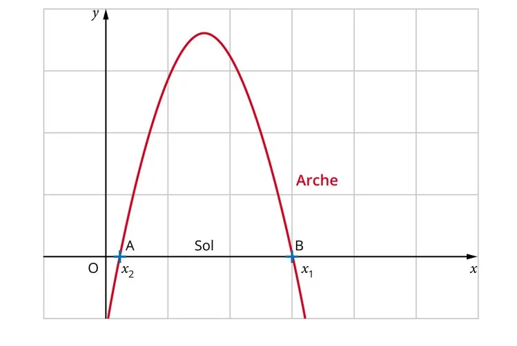

On s'intéresse à la prise au sol d'une arche qui suit la fonction $f$ définie par $f(x)=-0{,}8x^2+10{,}4x-9{,}6$.

L'objectif est de déterminer la distance AB au sol, qui correspond à la différence $x_1-x_2$ entre les deux valeurs de $x$ pour lesquelles $f(x)=0$.



La méthode consiste à déterminer par balayage une valeur approchée des valeurs de $x$ telles que $f(x)=0$.

1. On fixe la valeur de $x_2$ (abscisse du point A) à 1. Recopier et compléter le script ci-dessous pour que `sol()` renvoie une valeur approchée de $x_1$ à $10^{-1}$ près.

   ```python
   from math import *
   def f(x):
       y = .....
       return y
   def sol():
       x = .....
       while f(x) ..... :
           x = x + .....
       return x
   ```

2. Exécuter ensuite le programme en écrivant `sol()` dans la console d’exécution.
3. Relever la valeur de $x_1$.
4. Déduire des valeurs de $x_1$ et de $x_2$ la distance au sol AB de l'arche.
