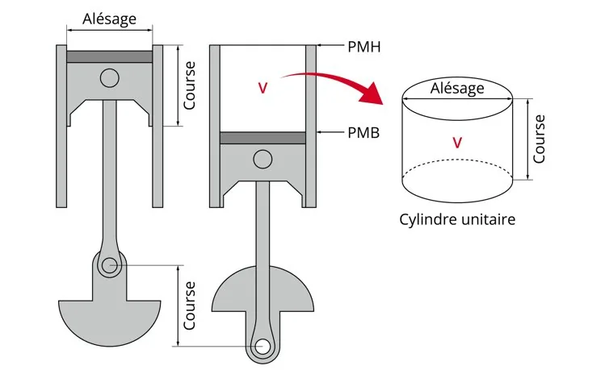

Dans le cadre d'une séance de co-intervention, les élèves s'intéressent à un distributeur automatique de savon de forme cylindrique.

1. Dessiner un cylindre avec GeoGebra en suivant le tutoriel [Tracer un cylindre en 3D](#outils-geogebra/o-gg-cylindre).
2. Voici les explications techniques fournies par le constructeur.

   

   En utilisant le vocabulaire mathématique, répondre aux deux questions.

   1. Que représente la course ?

   2. Que représente l’alésage ?

3. Dans GeoGebra :

   - modifier la valeur du rayon $R$ de la base ;
   - modifier la valeur de la hauteur $h$ du cylindre.

   Relever, à chaque modification, la valeur du volume $V$ du cylindre ainsi que celle de la section $S$ de la base.

   Dresser un tableau à 4 colonnes, une pour chaque grandeur, et y noter les valeurs.

4.
   1. Tracer la représentation graphique de la section de la base en fonction du rayon : $S=f(R)$.

   2. Tracer la représentation graphique du volume du cylindre en fonction de la hauteur : $V=f(h)$.

5. Parmi ces propositions, lesquelles sont correctes ?

   1. La représentation graphique de $S=f(R)$ est une droite.

   2. La représentation graphique de $S=f(R)$ est une parabole.

   3. La représentation graphique de $V=f(h)$ est une droite.

   4. La représentation graphique de $V=f(h)$ est une parabole.

6.
   1. Modéliser les deux représentations graphiques de la question **4** et relever l’équation de chaque modélisation.

      ::: remarque Aide
      Pour une modélisation avec la NumWorks : [Réaliser une modélisation](#outils-numworks/o-nw-modelisation) ; avec un tableur : [Réaliser une modélisation (courbe de tendance)](#outils-tableur/o-tab-modelisation), avec son tutoriel vidéo.
      :::

   2. La modélisation de $S=f(R)$ est de la forme $f(x)=kx^2$. Relever la valeur de $k$. À quoi correspond-elle ?

   3. Relever la valeur du coefficient directeur $a$ de la modélisation de $V=f(h)$. Que représente la valeur de $a$ ?

7. Comparer cette valeur du coefficient directeur avec l'expression du volume pour un cylindre.
