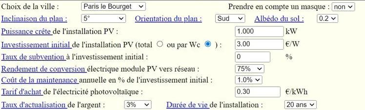
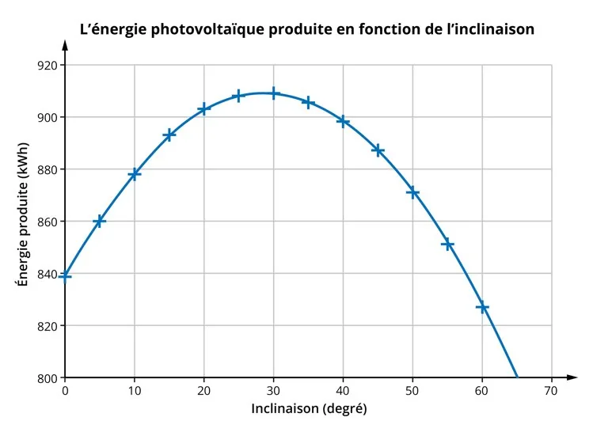

Lors d'une séance de co-intervention, les élèves s'intéressent à la production d'énergie photovoltaïque. L'énergie solaire est convertie par des panneaux photovoltaïques en une énergie électrique disponible au niveau du réseau. Cette énergie peut ensuite être utilisée directement et/ou partiellement revendue à un fournisseur.

Avec le logiciel en ligne CalSol, ils ont étudié comment l'énergie produite en une année varie en fonction de l'inclinaison du plan des panneaux solaires par rapport au sol. Les panneaux sont à Paris le Bourget avec les paramètres fixés ci-dessous. Seule varie l'inclinaison du plan entre 5° et 65°.

::: ouvrir http://ines.solaire.free.fr/pvreseau_1.php
:::

Voici la représentation graphique de la production annuelle (en kWh) obtenue en fonction de l'inclinaison des panneaux (en °).

1. Quelle est la forme de la représentation graphique ?

2. Construire le tableau de variation de la fonction représentée.

3. Pour quelle inclinaison l'énergie produite est-elle maximale ?

4. Donner la valeur maximale de l'énergie produite dans ces conditions, notée $E _{\text{max}}$.

5. Résoudre graphiquement $E=888~ \text{kWh}$.
