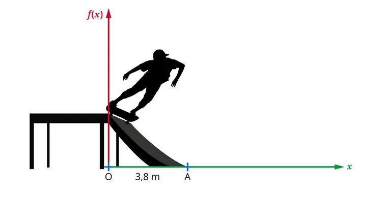

Un pratiquant de skate descend sur une rampe dont la courbure est donnée par la fonction $f(x) = 0{,}375 x^2$.

$f(x)$ représente la hauteur du skate sur la rampe et $x$ représente la position horizontale du skate comme indiqué sur le schéma.

1. Donner les variations de la fonction carré sur $[0~;+\infty[$ et la forme de sa représentation graphique.

2. En déduire les variations de la fonction $f(x)$ en justifiant la réponse.

3. Tracer la représentation graphique de la fonction $f$ à l'aide de la calculatrice (ou d'un logiciel).

4. Déterminer graphiquement et par le calcul $f(9)$.

5. Déterminer graphiquement la valeur de $x$ pour laquelle $f(x)=1$.
