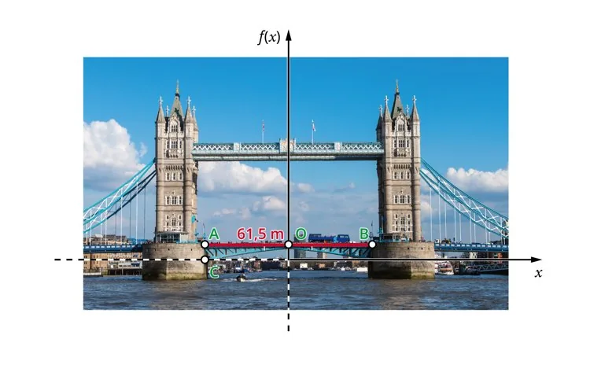

Le Tower Bridge est un pont très célèbre de Londres. C'est un pont levant : il permet aux véhicules et aux piétons de traverser la Tamise, et aux grands navires de passer. Les touristes viennent du monde entier admirer son architecture et les prouesses technologiques de la fin du XIXe siècle.

On s'intéresse à la forme du pont levant modélisée par la fonction $f$ définie par $f(x) =-4{,}76×10^{-3}×x^2$

avec :

- $f(x)$ : hauteur (en m) entre l'horizontale au niveau de la bascule et un point de la structure du pont levant ;
- $x$ : distance horizontale (en m).

::: problematique

- **Quelle est la hauteur maximale du pont levant ?**
- **Pour quelle raison le pont doit-il être levé au passage d'un bateau ?**

:::

1. Expliquer ce qui est attendu.

2. Tracer la représentation graphique de la fonction.

3. Déterminer $f(-30{,}75)$ et $f(30{,}75)$.

4. Construire le tableau de variations de la fonction $f$.

5. Tracer la droite d'équation $y=-4{,}5$ et rechercher les abscisses des points d'intersection de cette droite avec la courbe de $f$. Que représente concrètement cette droite par rapport au pont ?

6. Sachant que la hauteur entre la Tamise et le point C du pont (voir schéma) est approximativement égale à 4,5 m, quelle est la hauteur entre la Tamise et la chaussée du pont ?

7. En supposant que la hauteur d'un bateau est de 12 m, expliquer pour quelle raison le pont levant doit s'ouvrir.
