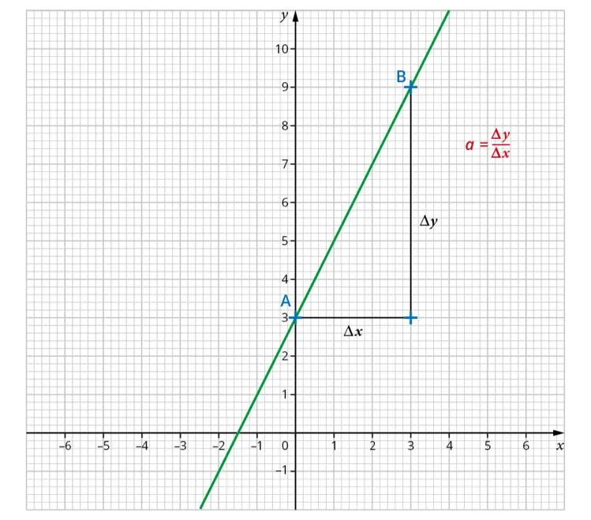

L’équation réduite d’une droite s’écrit sous la forme $y=ax+b$. On considère deux points $\text{A}(x_\text{A}; y_\text{A})$ et $\text{B}(x_\text{B}; y_\text{B})$ situés sur la droite.

**1. Le coefficient directeur** (ou taux d'accroissement) : $a=\dfrac{y_\text{B}-y_\text{A}}{x_\text{B}-x_\text{A}}$

**2. L'ordonnée à l'origine $b$ :**

on remplace $x$ et $y$ par les coordonnées $x_\text{A}$ et $y_\text{A}$ dans l'équation $y=ax+b$, ce qui donne $b=y_\text{A} -ax_\text{A}$, avec pour $a$ la valeur obtenue précédemment.

**Remarque :** on peut utiliser le même procédé avec les coordonnées du point B.
