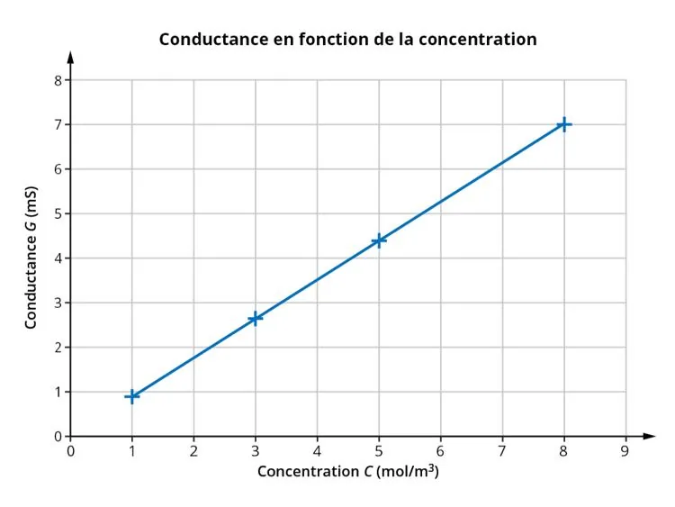

Afin de déterminer la concentration d'une solution inconnue A, on mesure la conductance de plusieurs solutions identiques à A (renfermant la même espèce chimique) mais avec des concentrations différentes. La conductance est la capacité d'une solution à conduire le courant électrique. Elle se mesure avec un conductimètre et s'exprime en siemens (S).

On réalise ainsi la courbe d'étalonnage suivante.

1. Comment évolue la conductance en fonction de la concentration ? Cette affirmation semble-t-elle logique et cohérente d'un point de vue chimique ?

2. À partir de deux points, déterminer l'équation de la droite sous la forme $y=ax+b$.

3. Calculer les deux valeurs suivantes.

   1. La conductance en mS pour une concentration de 2,5 mol/m³.

   2. La concentration pour une conductance de 4 mS.

4. La conductance étant l'inverse de la résistance, en déduire la valeur de la résistance dans les deux cas précédents.
