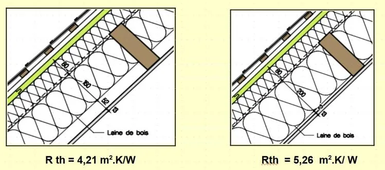

Une famille souhaite isoler les combles avec de la laine de bois. Elle se rapproche d'un professionnel travaillant dans un bureau d'études qui lui fournit les renseignements suivants.

Les valeurs des épaisseurs sont exprimées en mm.

Comme on le voit sur le document, la laine de bois est la partie centrale.

1. Dans un tableur, faire un tableau avec deux colonnes, la première pour l'épaisseur notée $e$ (en mm), la seconde pour la résistance thermique notée $R_{th}$ (en m²·K/W).

   Ajouter une troisième colonne avec les épaisseurs converties en mètres.

2. Tracer la représentation graphique de $R_{th}=f(e)$ et la modéliser sous la forme $R_{th}=a×e+b$. Arrondir les coefficients à $10^{-2}$.

3. Retrouver par le calcul les valeurs de $a$ (coefficient directeur) et de $b$ (ordonnée à l'origine).

4. En déduire l'expression de $R_{th}$ en fonction de $e$.

5. Le coefficient directeur de la droite ainsi obtenue correspond à $1/ \lambda$ avec $\lambda$ la conductivité thermique exprimée en W/m·K. En déduire la valeur de la conductivité thermique en W/m·K.

6. Calculer la valeur de l'épaisseur $e$, en m puis en mm, nécessaire pour avoir une résistance thermique $R_{th}=4{,}39$ m²·K/W.
