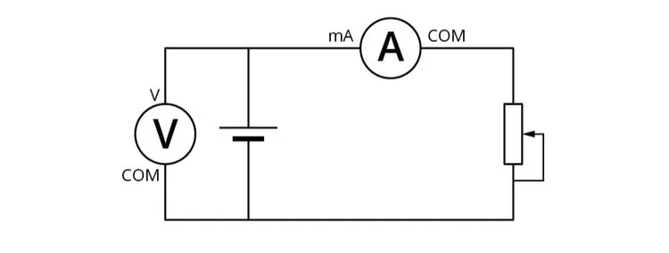
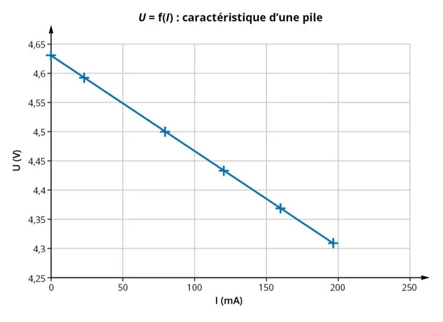

Afin de tracer la caractéristique d'une pile, on réalise le montage suivant.

On fait varier la position du rhéostat et on mesure pour chaque position :

- l’intensité du courant $I$ circulant dans le circuit ;
- la tension $U$ aux bornes de la pile.

Voici la caractéristique $U=f(I)$ de la pile obtenue.

1. À quel type de fonction correspond $U=f(I)$ ?

2. La représentation graphique est une droite. Calculer le coefficient directeur $a$ de la droite (avec $I$ exprimée en ampères) ainsi que l’ordonnée à l’origine $b$.

3. L'opposé du coefficient directeur correspond à la résistance interne de la pile, notée $r$, et l’ordonnée à l’origine correspond à la tension à vide, notée $U_0$. Donner les valeurs de ces deux grandeurs physiques en précisant leurs unités.

4. En déduire la relation $U=f(I)$ avec $r$ et $U_0$.
