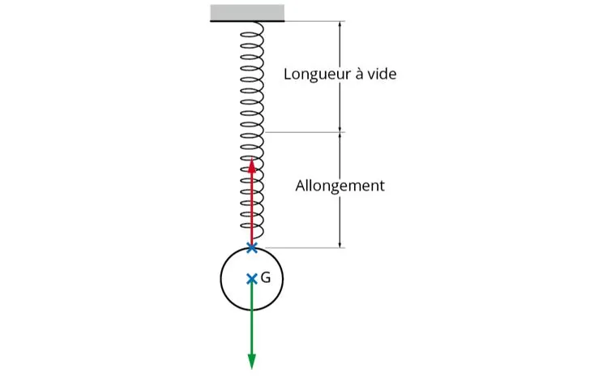

On considère un ressort. Quand aucune masse n'est accrochée à son extrémité, sa longueur appelée « longueur à vide » est égale à 20 cm. On suspend une masse de 10 g à l'extrémité du ressort qui s'allonge jusqu'à une longueur de 22 cm.

Les forces exercées sont représentées :

- en vert, le poids $\overrightarrow{P}$ de l'objet (la masse) ;
- en rouge, la force de rappel $\overrightarrow{T}$ du ressort.

1. Quelle est la valeur de l'allongement ?

2. Ouvrir le fichier ci-dessous dans un tableur et ajouter deux colonnes : l'une pour la masse en kg et l'autre pour l'allongement en m.

   ::: fichier fichiers/allongement-ressort.xlsx
   :::

3. Tracer la représentation graphique de l'allongement (en m) en fonction de la masse (en kg). L'allongement et la masse sont-ils deux grandeurs proportionnelles ? Justifier la réponse.

4.
   1. Calculer le coefficient directeur de la droite tracée en utilisant deux points judicieusement choisis.

   2. Vérifier cette valeur en effectuant la modélisation graphique.

5. Le coefficient directeur de la droite correspond au rapport $g/k$ avec :

   - $g$ : intensité de la pesanteur terrestre égale à 9,8 N/kg ;
   - $k$ : constante de raideur en N/m.

   En déduire la valeur de la raideur $k$ du ressort.

6. L'expression de la force de rappel est : $T=k×ΔL$. Donner l'expression de la force en remplaçant $k$ par la valeur trouvée à la question précédente.

7. Calculer la valeur de la masse en kg pour un allongement de 0,15 m. Convertir alors la masse en g et l'allongement en cm.
