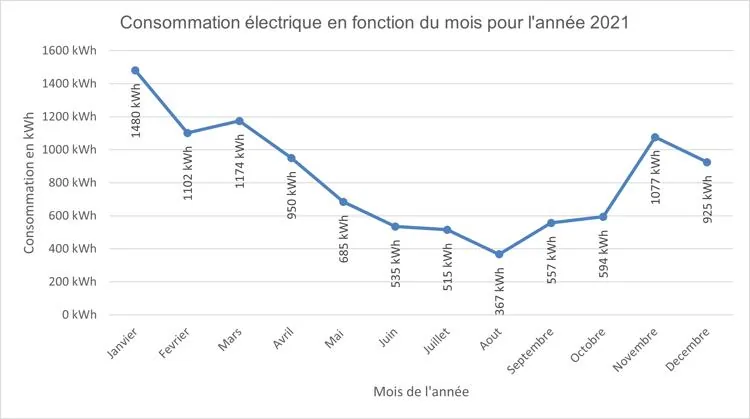

Le graphique montre l'évolution de la consommation électrique d'une famille composée de deux adultes et de deux enfants sur l'année 2021.

::: problematique
Comment évolue la consommation électrique d'une famille (deux adultes et deux enfants) sur une année donnée ? La réponse est-elle la même pour les deux années suivantes ?
:::

1. Décrire l'évolution de la consommation électrique au cours de 2021 en utilisant les mots suivants : croissante, décroissante, maximale, minimale, constante.

2.
   1. Quelle est la consommation maximale ?

   2. En quel mois est-elle atteinte ?

3.
   1. Quelle est la consommation minimale ?

   2. En quel mois est-elle atteinte ?

   3. Quelle(s) raisons pourraient justifier de telles consommations ainsi que l'évolution globale ?

4. Les données de consommation des années 2021 à 2023 sont relevées dans le fichier ci-dessous. Le télécharger puis l'ouvrir dans un tableur.

   ::: fichier fichiers/consommation-electrique.xlsx
   :::

   Tracer dans ce fichier les représentations graphiques de 2022 et de 2023.

5. Analyser les représentations graphiques obtenues : les extremums sont-ils atteints au même moment de l'année ? Justifier la réponse et expliquer les résultats obtenus.
