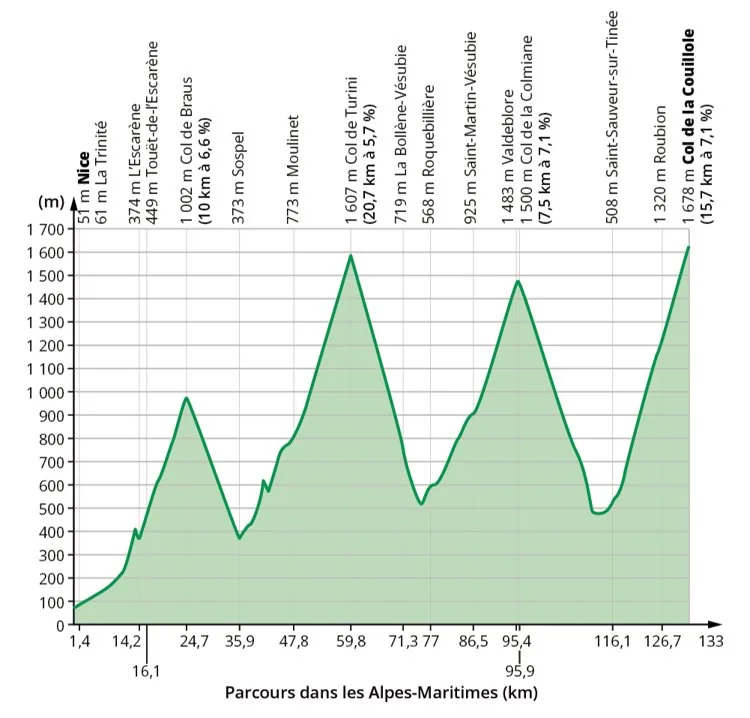

Voici le profil d'une étape du Tour de France 2024 dans les Alpes-Maritimes.

::: problematique
Ce parcours est-il régulier dans les phases d'ascensions et de descentes ?

Sur quelles parties de l'étape les coureurs peuvent-ils rencontrer les difficultés les plus importantes ?
:::

1. Quelles sont les indications portées sur l'ensemble du parcours ?

2.
   1. À quel endroit les coureurs atteindront-ils l'altitude la plus élevée ?

   2. Quelle distance auront-ils alors parcourue depuis le départ, à Nice ?

3. Pour quel pic le dénivelé sera-t-il le plus important ?

4. Répondre aux problématiques.
