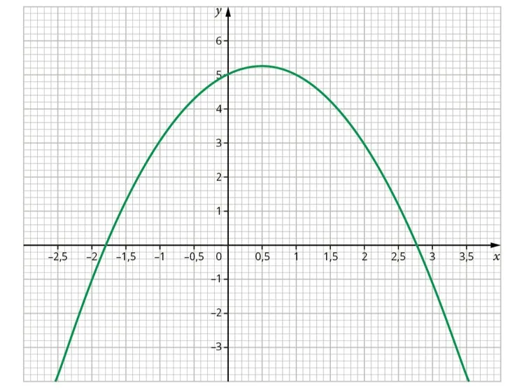

Voici la représentation graphique d'une fonction notée $f(x)$.

1. Déterminer graphiquement l’image de 1.

2. Déterminer graphiquement $f(-2)$.

3. Déterminer graphiquement les antécédents de 3.

4. Déterminer graphiquement les antécédents de $-1$.

5. Construire le tableau de variations de la fonction ainsi représentée.
