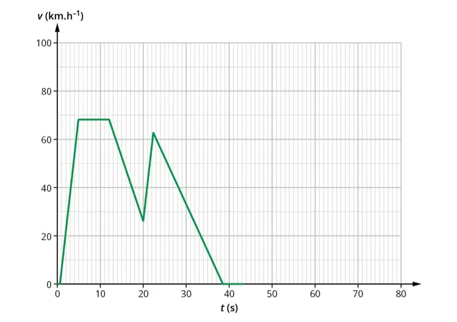

Voici le graphe représentant l'évolution de la vitesse $v$ d'une moto, exprimée en km/h, en fonction du temps $t$ en secondes.

1. Décrire les variations de la vitesse au cours du temps.

2. Quelle est la vitesse maximale atteinte ?

3. À quels moments la vitesse est-elle minimale ?

4. Pendant quelle durée la vitesse reste-t-elle constante ?
