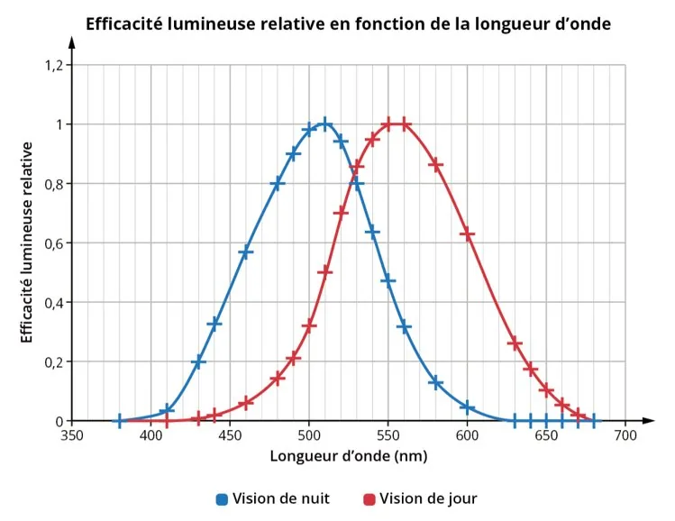
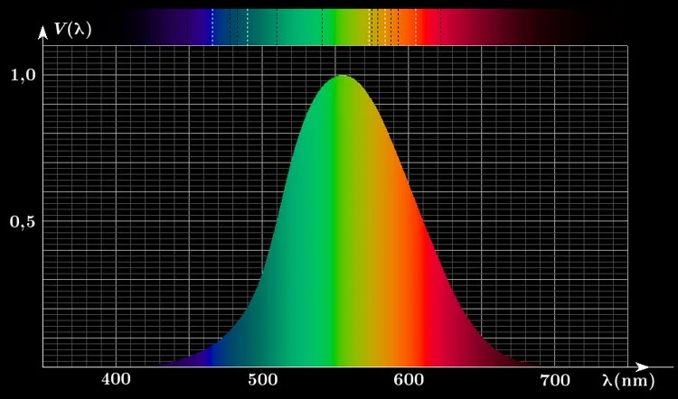

L'œil réagit différemment selon la longueur d'onde de la lumière qu'il perçoit et cette sensibilité varie entre le jour et la nuit. Cette différence de perception est mesurée par l'efficacité lumineuse spectrale.

Voici les représentations graphiques de l'efficacité lumineuse spectrale relative en fonction de la longueur d'onde, de jour et de nuit.

1. Construire le tableau de variations correspondant à l'évolution de l'efficacité lumineuse en fonction de la longueur d'onde.

   On note : $E_J=f(\lambda)$ pour le jour et $E_N=f(\lambda)$ pour la nuit.

2. Pour quelle longueur d'onde l'efficacité lumineuse est-elle maximale le jour ? Et la nuit ?

3. En déduire, à partir du spectre suivant, les couleurs correspondant aux efficacités lumineuses, le jour et la nuit.

   
