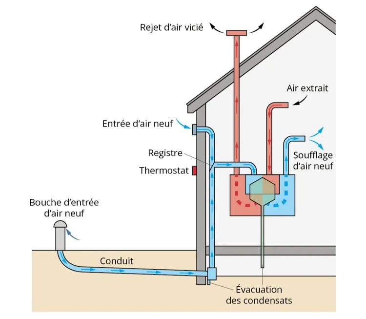
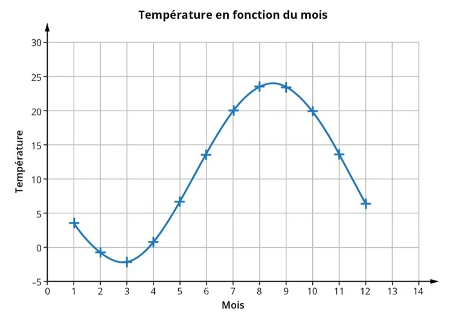

Le puits canadien est un système de ventilation des bâtiments. En hiver, l’air extérieur plus froid est préchauffé naturellement par le sol (géothermie) avant d’entrer dans la maison. En été, le sol plus frais permet de rafraîchir l’air avant qu’il ne pénètre à l’intérieur.

On fournit les valeurs de la température extérieure en fonction du temps (mois).

1. À partir de la représentation graphique, construire le tableau de variations de la fonction représentant l'évolution de la température extérieure au cours du temps.

2.
   1. En quel mois le maximum est-il atteint ?

   2. Quelle est la température maximale ?

   3. Quel rôle jouera alors le puits ?

3. À quels moments de l'année le puits diffuse-t-il le plus d'air de l'extérieur vers l'intérieur ? Justifier la réponse en s'appuyant sur la représentation graphique.
