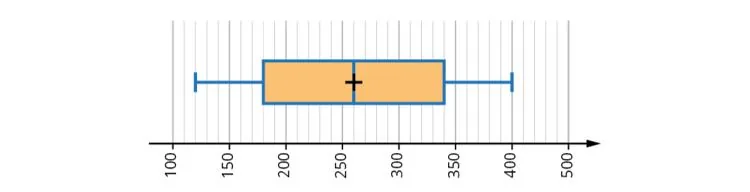

Un administrateur de site internet souhaite analyser les temps de réponse des chargements de pages sur son site. Pour cela, il a collecté des données sur une journée donnée et souhaite comprendre la distribution de ces temps de réponse afin d'optimiser les performances du site.

### Partie A — Analyse des données

Voici les données des temps de réponse (en millisecondes) sous la forme d'un diagramme en boîte.

::: coup-de-pouce x-boite
:::

1. Quels sont les temps minimum et maximum enregistrés pour le chargement d'une page ?

2. Quelle est la médiane des temps de réponse ?

3. Comparer la médiane aux valeurs de $Q_1$ et $Q_3$. Que peut-on en déduire sur la distribution des données ?

4. Calculer l'écart interquartile.

5. Que représente l'écart interquartile en termes de dispersion des données ?

### Partie B — Création d'un diagramme en boîte

On dispose des temps de réponse suivants (en millisecondes) pour un autre jour :

120 ; 140 ; 160 ; 180 ; 200 ; 220 ; 240 ; 260 ; 280 ; 300 ; 320 ; 340 ; 360 ; 380 ; 400.

1. Déterminer les temps minimum et maximum.

2. Calculer la médiane des temps de réponse.

3. Comparer les résultats obtenus avec ceux de la partie **A**.

4. Calculer les valeurs de $Q_1$ et $Q_3$.

5. Quelle est la valeur de l'écart interquartile ?

6. Comment peut-on interpréter cet écart interquartile par rapport à celui de la partie **A** ?

7. Construire le diagramme en boîte à moustaches de ces données avec la calculatrice.
