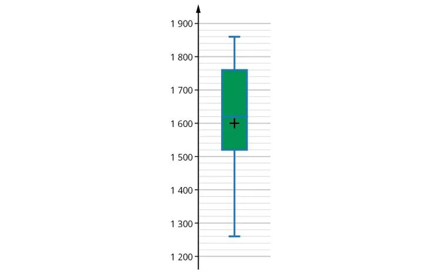

Ce diagramme offre une représentation visuelle des indicateurs clés d'une série statistique : la valeur minimale, la valeur maximale, la médiane et les quartiles. Il permet de comparer et d'interpréter plusieurs séries statistiques.

En général, plus la dispersion des valeurs de la série est grande, plus la boîte et les « moustaches » sont étendues.

**Exemple :** salaires mensuels des employés d'une entreprise.

- La médiane des salaires est $M_e = 1\,624$ €.
- Le salaire minimum est de 1 257 € et le salaire maximum de 1 854 € : l'étendue est $e = 597$ €.
- Le premier quartile est $Q_1 = 1\,520$ € et le troisième quartile $Q_3 = 1\,754$ € : au moins 25 % des salariés gagnent 1 520 € ou moins, et au moins 75 % gagnent 1 754 € ou moins.
- L'écart interquartile est $Q_3-Q_1 = 234$ €.
