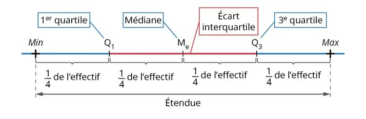

En statistique, les indicateurs de dispersion sont l'étendue, l'écart type et l'écart interquartile.

**Définitions**

- L'**étendue** $e$ est la différence entre la valeur maximale et la valeur minimale de la série.
- L'**écart type** $\sigma$ mesure la dispersion des valeurs de la série autour de la moyenne $\overline{X}$. Dans une distribution normale :
  - environ 68 % des valeurs se situent dans l'intervalle $[\overline{X}-\sigma~;\overline{X}+\sigma]$ ;
  - environ 95 % des valeurs se situent dans l'intervalle $[\overline{X}-2\sigma~;\overline{X}+2\sigma]$ ;
  - environ 99,7 % des valeurs se situent dans l'intervalle $[\overline{X}-3\sigma~;\overline{X}+3\sigma]$.
- L'**écart interquartile** $EI=Q_3-Q_1$ est la différence entre le troisième et le premier quartile (voir la fiche « Indicateurs de position »). Il mesure la dispersion de la moitié centrale des valeurs, autour de la médiane.

Une série statistique peut ainsi être caractérisée par le couple (moyenne ; écart type) ou par le couple (médiane ; écart interquartile), ce qui permet de comparer plusieurs séries.

**Exemple**

On mesure la taille (en centimètres) de 15 plantes dans un jardin botanique : 25 ; 27 ; 30 ; 32 ; 33 ; 35 ; 36 ; 38 ; 40 ; 42 ; 45 ; 47 ; 48 ; 50 ; 52.

- L'étendue est $e=52-25=27\text{ cm}$ : elle est importante par rapport à la taille des plantes, ce qui indique une grande variation.
- La moyenne est $\overline{X}\approx 38{,}67\text{ cm}$ et l'écart type, calculé avec la calculatrice, est $\sigma\approx 8{,}2\text{ cm}$. Environ 68 % des plantes ont donc une taille comprise entre $\overline{X}-\sigma\approx 30{,}5\text{ cm}$ et $\overline{X}+\sigma\approx 46{,}9\text{ cm}$.
- On calcule $Q_1 = 32\text{ cm}$, $M_e=38\text{ cm}$ et $Q_3=47\text{ cm}$. On en déduit l'écart interquartile : $EI = Q_3-Q_1=15\text{ cm}$. Au moins la moitié des plantes ont une taille comprise entre 32 cm et 47 cm.
