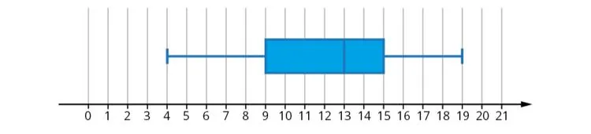

Un responsable de la maintenance informatique collecte des données sur les temps de réparation (en heures) pour les pannes courantes. Voici les temps de réparation sous la forme d'un diagramme en boîte.

1. Déterminer la médiane $M_e$.

2. Déterminer le premier quartile $Q_1$ et le troisième quartile $Q_3$.

3. Calculer l'écart interquartile.

4. Déterminer le minimum et le maximum.

5. Calculer l'étendue.
