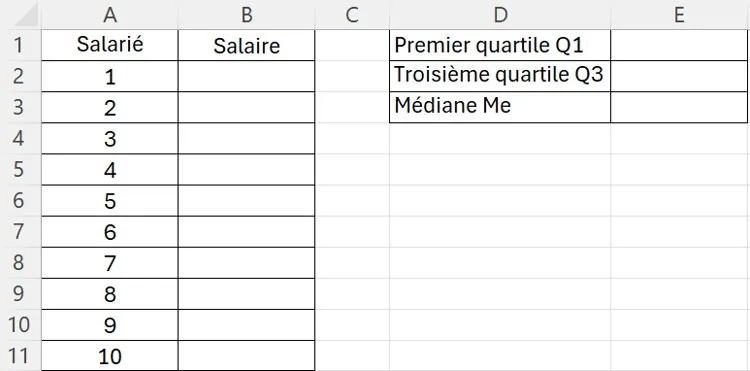

Un comptable recense les salaires annuels de dix employés d'une entreprise :

30 000 € ; 35 000 € ; 40 000 € ; 45 000 € ; 50 000 € ; 55 000 € ; 60 000 € ; 65 000 € ; 70 000 € ; 75 000 €.

1. Calculer le premier quartile $Q_1$, la médiane $M_e$ et le troisième quartile $Q_3$.

2. Calculer l'écart interquartile.

3. Dans un fichier tableur, recopier et compléter les salaires des 10 salariés comme ci-dessous.

   

4. Dans la cellule **E1**, appliquer la formule « **=QUARTILE(B2:B11;1)**».

5. Dans la cellule **E2**, appliquer la formule « **=QUARTILE(B2:B11;3)** ».

6. Dans la cellule **E3**, appliquer la formule « **=MEDIANE(B2:B11)** ».

7. Comparer les valeurs obtenues avec celles trouvées à la question **1**. Comment expliquer les éventuelles différences ?
