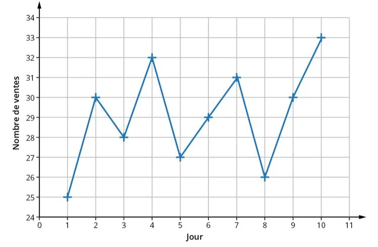
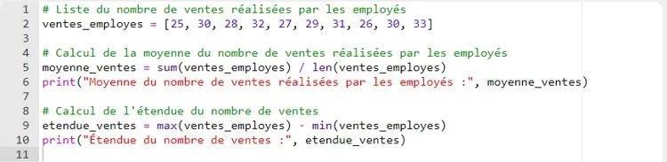

Une entreprise souhaite évaluer les performances de ses employés en termes de nombre de ventes réalisées sur une période de 10 jours. Voici le nombre de ventes effectuées chaque jour.

1. Calculer la moyenne du nombre de ventes réalisées par les employés.

2. Calculer l'étendue du nombre de ventes.

3. Recopier et exécuter le programme Python ci-dessous dans une console Python, par exemple la console Basthon.

   ::: ouvrir https://console.basthon.fr/
   :::

   

4. Comparer les résultats des questions **1** et **2** avec ceux du programme Python.

5. Les ventes d'un employé avaient été oubliées. Il n'avait travaillé que le quatrième jour et avait réalisé 2 ventes ce jour-là. Modifier le programme pour inclure ce nouvel employé puis l'exécuter pour recalculer la moyenne et l'étendue.
