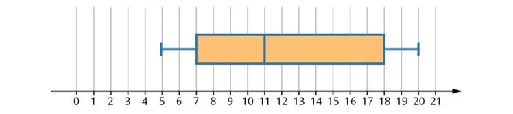

**Étapes**

1. Calculer la valeur minimale, le premier quartile $Q_1$, la médiane $M_e$, le troisième quartile $Q_3$ et la valeur maximale.
2. Tracer un **axe gradué** adapté aux valeurs de la série.
3. Tracer un **rectangle** (la boîte) qui s'étend de $Q_1$ à $Q_3$.
4. Tracer **un trait** à l'intérieur du rectangle pour représenter la médiane $M_e$.
5. Tracer **des segments** (les moustaches) de part et d'autre du rectangle, jusqu'aux valeurs extrêmes (minimum et maximum).

**Exemple :** série 5 ; 7 ; 8 ; 10 ; 12 ; 18 ; 19 ; 20.

$N=8$ : $Q_1$ est la valeur de rang 2, soit 7 ; $Q_3$ est la valeur de rang 6, soit 18 ; $M_e=\dfrac{10+12}{2}=11$. Le minimum vaut 5 et le maximum 20.

