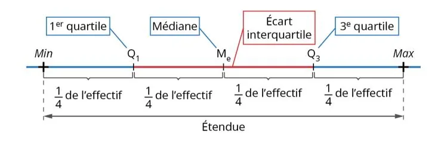

Les quartiles partagent la série en quatre parties de même effectif (ou presque).

**Premier et troisième quartiles**

1. **Classer** les données par ordre croissant.
2. Calculer l'**effectif** $N$, puis $\dfrac{N}{4}$ et $\dfrac{3N}{4}$.
3. Le rang du premier quartile $Q_1$ est le premier entier supérieur ou égal à $\dfrac{N}{4}$. Le rang du troisième quartile $Q_3$ est le premier entier supérieur ou égal à $\dfrac{3N}{4}$.

**Écart interquartile**

L'écart interquartile $EI$ est la **différence** entre le troisième et le premier quartile : $EI=Q_3-Q_1$.
