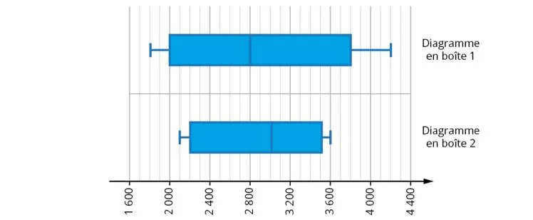

Mustapha et Sofiane sont impliqués dans deux partis politiques différents lors des élections municipales. Ils souhaitent comparer le nombre de votes obtenus par leurs partis dans différents quartiers de la ville. Ils ont enregistré les résultats dans le tableau suivant.

| Parti politique | Parti A | Parti B |
|---|---|---|
| Quartier 1 | 2 500 | 2 200 |
| Quartier 2 | 2 800 | 3 000 |
| Quartier 3 | 3 200 | 3 500 |
| Quartier 4 | 3 800 | 3 600 |
| Quartier 5 | 4 200 | 3 300 |
| Quartier 6 | 2 000 | 2 500 |
| Quartier 7 | 1 800 | 2 100 |

1. Calculer la médiane du nombre de votes pour chaque parti.

2. Calculer le premier et le troisième quartile pour chaque parti.

3. Calculer l'étendue des votes pour chaque parti.

4. Associer les diagrammes en boîte aux partis politiques.

   

5. Déterminer les écarts interquartiles de chaque parti.

6. En déduire le parti dont les résultats sont les moins dispersés.
