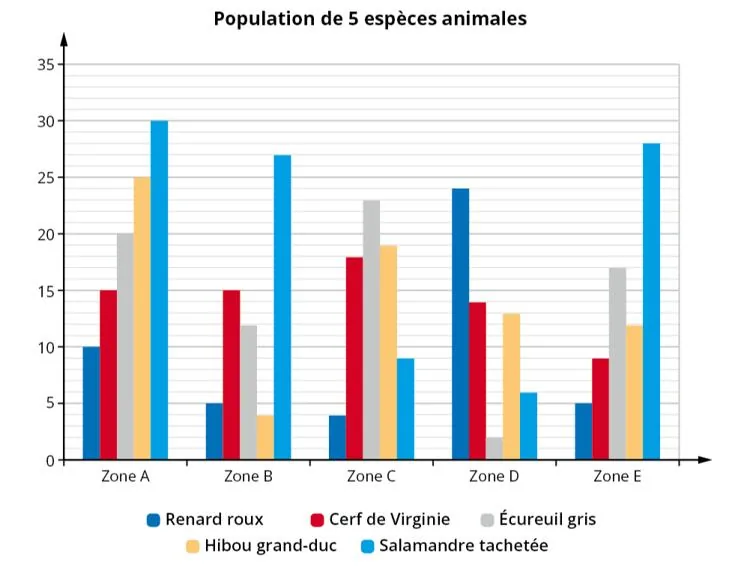

Un groupe d'écologistes étudie la population animale dans différentes zones d'une réserve naturelle. Ils collectent des données sur le nombre d'animaux de cinq espèces dans chaque zone.

Le graphique représente le nombre d'animaux de chacune des espèces dans cinq zones de la réserve.

::: problematique
Quelle zone présente la plus grande population animale ?
:::

1. Calculer la médiane $M_e$, le premier quartile $Q_1$ et le troisième quartile $Q_3$ du nombre d'animaux dans chaque zone.

2. Interpréter les résultats.

3. Un écologiste affirme que, dans l'une des cinq zones, au moins 75 % des espèces comptent 25 animaux ou moins, et que 25 est le troisième quartile de cette zone. De quelle zone parle-t-il ?

4. Quel indicateur permet de savoir dans quelle zone il y a le plus d'animaux ?

5. Répondre à la problématique.
