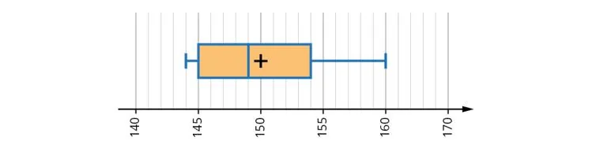

Khadija et Saliha travaillent dans une usine de fabrication de moteurs. Elles sont responsables du contrôle qualité des pièces produites. Lors de leur dernier contrôle, elles ont examiné la résistance de dix pièces de moteur chacune.
Les résistances des pièces de Khadija sont les suivantes : 150 Ω, 155 Ω, 148 Ω, 152 Ω, 160 Ω, 145 Ω, 150 Ω, 155 Ω, 148 Ω et 152 Ω.

::: problematique
Laquelle des deux séries de pièces est de meilleure qualité ?
:::

1. Calculer la résistance médiane, le premier quartile et le troisième quartile des pièces de Khadija.

2. À l'aide d'une calculatrice graphique, représenter le diagramme en boîte des résistances des pièces de Khadija.

3. Saliha a également examiné les résistances de dix pièces de moteur et a représenté ses résultats sous forme d'un diagramme en boîte.

   

   Lire sur le diagramme de Saliha la médiane, le premier quartile et le troisième quartile.

4. Indiquer qui a obtenu la meilleure résistance médiane.

5. Pour quelle série la dispersion des résistances est-elle la plus faible ?

6. Répondre à la problématique.
