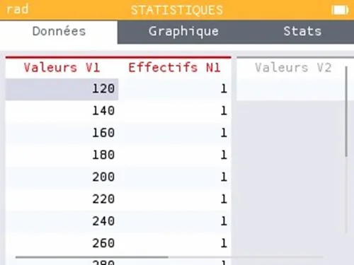
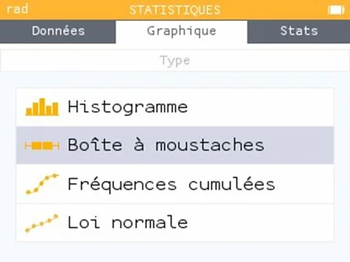
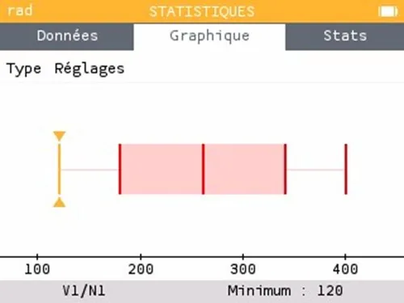

1.  Sélectionner l'application « Statistiques ».

    

2.  Saisir les valeurs dans la colonne V1 et les effectifs dans la colonne N1.

    

3.  Aller dans « Graphique » puis sélectionner « Boîte à moustaches ».

    

4.  Déplacer le curseur avec les flèches pour lire les valeurs des indicateurs.

    
