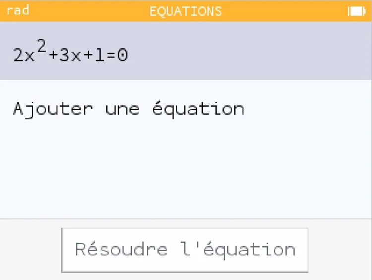
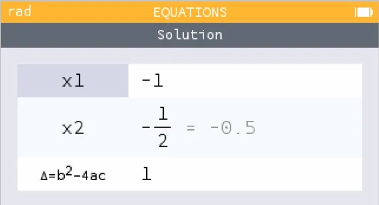

1.  **Aller dans l'application « Équations »** et valider avec **OK**.

    

2.  **Ajouter une équation**, la saisir, puis valider avec **OK**.

    

3.  **Se déplacer jusqu'à « Résoudre l'équation »** et valider avec **OK**.

4.  **Lire** le résultat.

    
