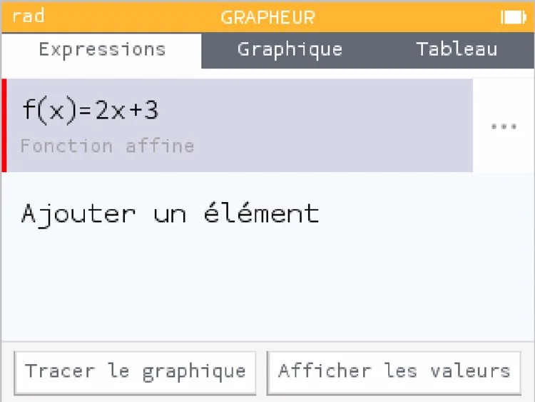
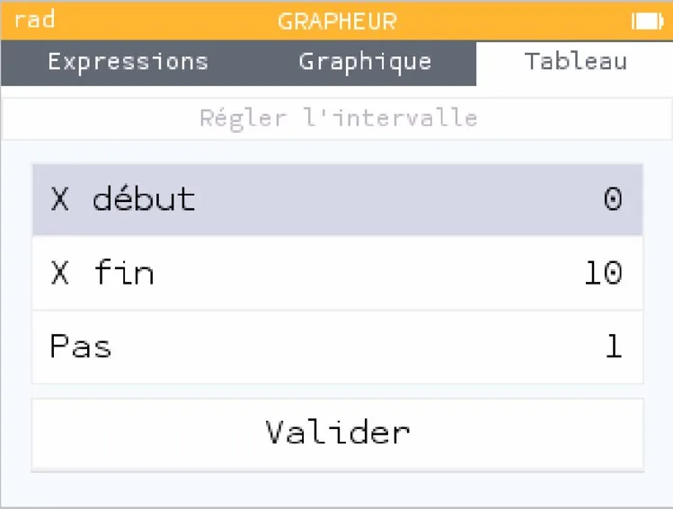
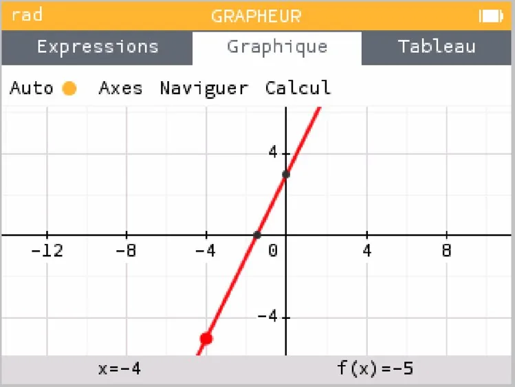
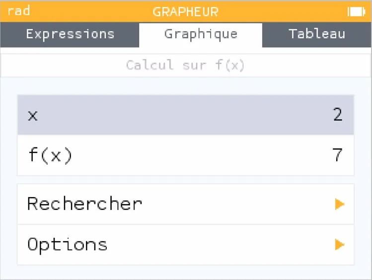

1.  Aller dans l'application **« Grapheur »**.

    

2.  Rester dans l'onglet « Expressions » et **saisir l'expression** de la fonction.

    

3.  Aller dans l'onglet **« Tableau »** et choisir **« Régler l'intervalle »** pour choisir l'intervalle de définition.

    

4.  Aller dans l'onglet **« Graphique »** pour afficher la représentation graphique de la fonction.

    

5.  Aller dans le sous-onglet « Calcul » pour rechercher des images ou des antécédents.

    
