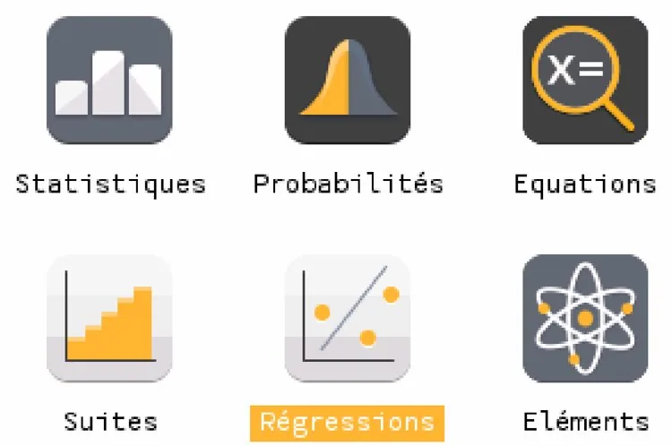
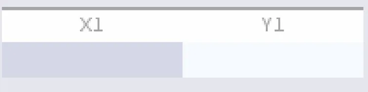
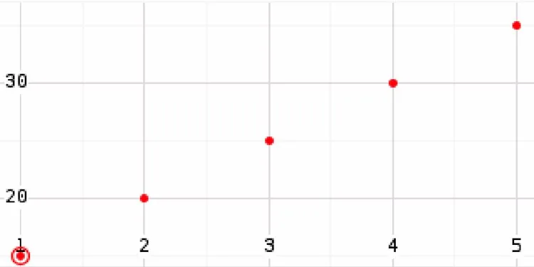
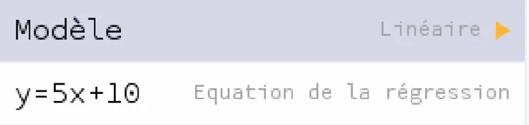

1.  **Entrer les données.** Dans l'application « Régressions », entrer les données dans un tableau à deux colonnes (jusqu'à trois tableaux possibles).

    

    

    Dans la colonne X1, saisir les valeurs de la première variable ; dans la colonne Y1, celles de la seconde variable.

2.  **Afficher le nuage de points.** Sélectionner l'onglet « Graphique » en haut de l'écran avec les flèches, puis valider avec la touche **EXE**.

    

    Les points représentant les données s'affichent.

    

3.  **Afficher un modèle de régression.**
    - Dans l'onglet « Graphique », appuyer sur **OK** pour afficher la liste des modèles disponibles.

    - Choisir le modèle souhaité, par exemple **Linéaire**, puis valider avec **OK**.

    - Aller dans « Régressions » et valider : l'équation de régression s'affiche.

      
