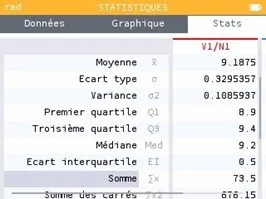
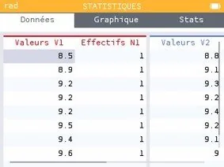

1.  Sélectionner l'application « Statistiques ».

    

2.  **Entrer les valeurs** de la série A dans V1 et celles de la série B dans V2, puis compléter les effectifs de chaque valeur (1 dans cet exemple).

    

3.  Aller dans l'**onglet « Stats »** et naviguer pour afficher les indicateurs des deux séries.
