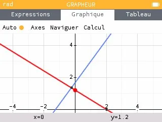
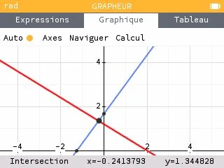

1.  Aller dans l'application **« Grapheur »**.

    

2.  **Saisir** les deux équations dans l'onglet « Expressions ».

    

3.  Choisir **« Tracer le graphique »**.

    

    Le résultat s'affiche dans l'onglet « Graphique ».

    

4.  Rechercher les **coordonnées du point d'intersection** : se déplacer sur les droites jusqu'à leur intersection, les coordonnées s'affichent.

    
