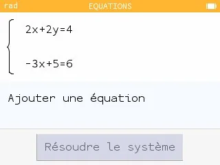
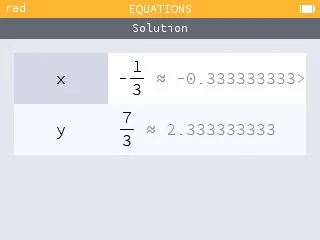

1.  Aller dans l'application **« Équations »**.

    

2.  **Saisir** les équations.
    - Saisir la première équation.

      

    - Choisir « Ajouter une équation » et saisir la deuxième équation.

      

3.  **Résoudre** le système.

    

    Les solutions $x$ et $y$ s'affichent :

    
