1.  **Les variables** sont des espaces de stockage des données. Elles peuvent contenir des nombres, des chaînes de caractères ou des booléens (True ou False).

    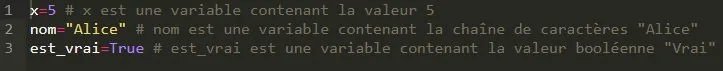

2.  Python utilise **différents types de données**, par exemple :

    - des nombres entiers : **int** ;
    - des nombres décimaux : **float** ;
    - des chaînes de caractères : **str** ;
    - des valeurs logiques (booléens) : **bool**.

3.  **Afficher des données** : la fonction **print()** affiche les données.

    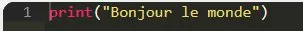

    À l'exécution :

    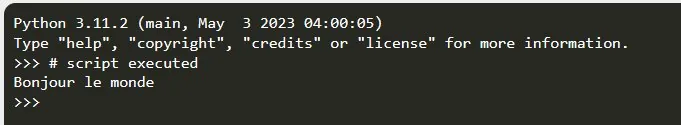

4.  **Les opérations arithmétiques**

    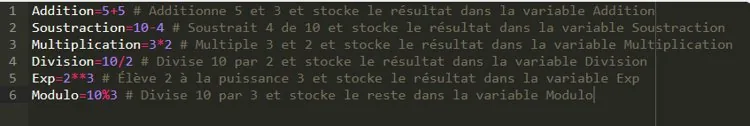

5.  **Les instructions conditionnelles** exécutent différentes parties du code selon des conditions.

    - **if** introduit une condition : si elle est vérifiée, le code en retrait sous le if est exécuté.
    - **elif** (abréviation de « else if ») introduit une condition supplémentaire si la précédente n'est pas vraie.
    - **else** introduit le code exécuté si aucune des conditions précédentes n'est vraie.

6.  **Les comparateurs** comparent des valeurs pour vérifier des conditions.

    | Symbole       | `>`         | `<`         | `>=`                | `<=`                | `==`   | `!=`         |
    |---------------|-------------|-------------|---------------------|---------------------|--------|--------------|
    | Signification | supérieur à | inférieur à | supérieur ou égal à | inférieur ou égal à | égal à | différent de |

    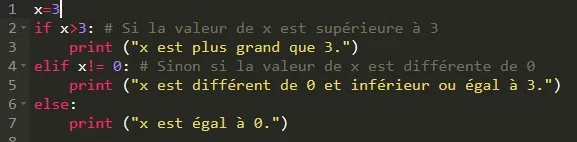

7.  **Les opérateurs d'appartenance et d'identité**

    - **in** vérifie si un élément est présent dans une séquence ;

    - **is** vérifie si deux objets sont le même objet en mémoire.

      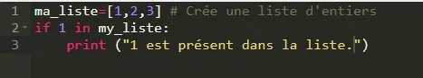

      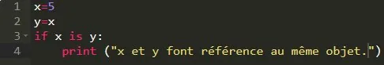

8.  **Les opérateurs logiques** combinent des conditions.

    - **not** inverse la valeur logique d'une condition ;

    - **and** renvoie « Vrai » si toutes les conditions sont vraies ;

    - **or** renvoie « Vrai » si au moins une condition est vraie.

      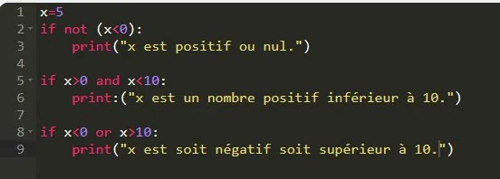

9.  **Les boucles**

    - Une boucle **while** répète un bloc de code tant qu'une condition est vraie. Le programme suivant affiche les nombres de 0 à 4.

      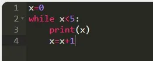

    - Une boucle **for** répète un bloc de code pour chaque élément d'une séquence. Ce programme affiche aussi les nombres de 0 à 4.

      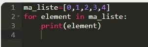

10. **Les fonctions min() et max()** renvoient le plus petit et le plus grand élément d'une séquence.

    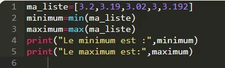
