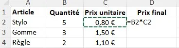
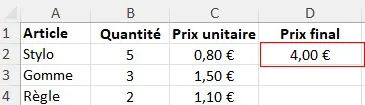
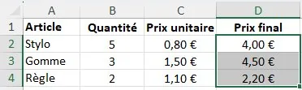

1.  **Saisir la formule**, puis appuyer sur « Entrée ».

    

2.  **Sélectionner la cellule** qui contient la formule.

    

3.  **Placer le pointeur de la souris en bas à droite de la cellule** : une petite croix apparaît. Cliquer, maintenir, puis faire glisser jusqu'à la cellule voulue.

    
