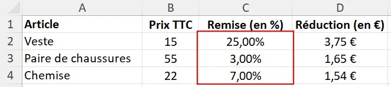
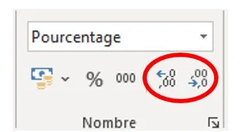
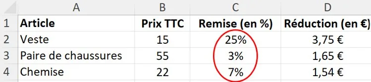

**Exemple :** on veut afficher la remise sans chiffre après la virgule.

1.  **Sélectionner** la ou les cellules.

    

2.  Dans le groupe « Nombre » de l'onglet « Accueil », cliquer sur « Ajouter une décimale » ou « Réduire les décimales ».

    

3.  Ici, deux clics ont enlevé les deux chiffres après la virgule.

    
