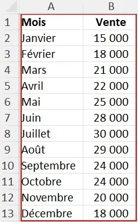
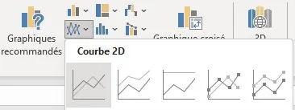
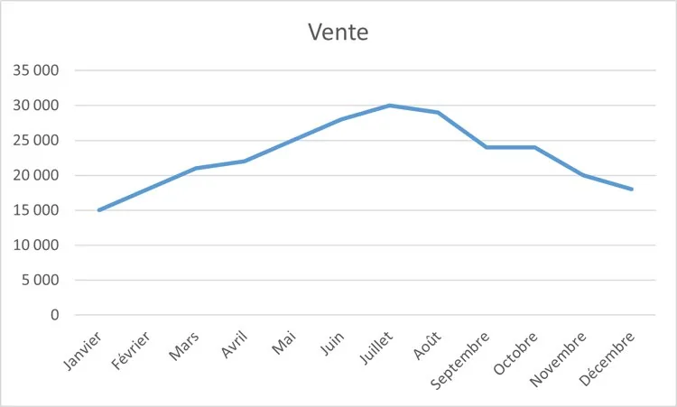

1.  **Sélectionner** les données à représenter.

    

2.  Dans le groupe « Graphiques » de l'onglet « Insertion », **choisir** le type de graphique, ici une courbe 2D.

    

3.  Le graphique apparaît : il reste à le **personnaliser** (voir la fiche suivante).

    
