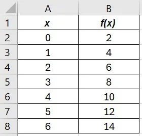
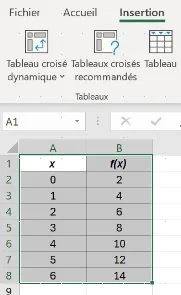
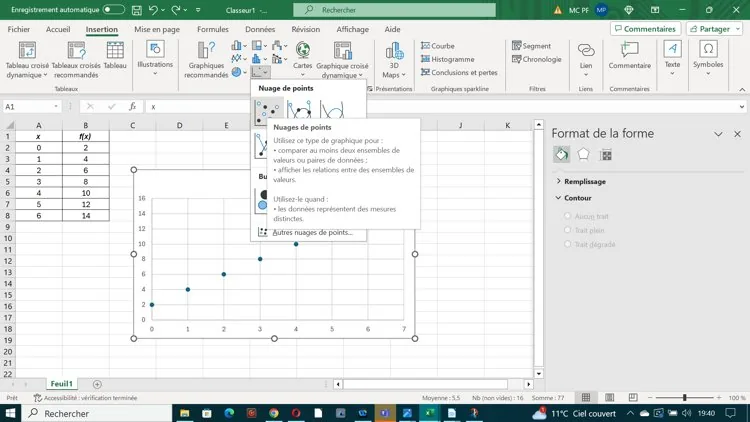
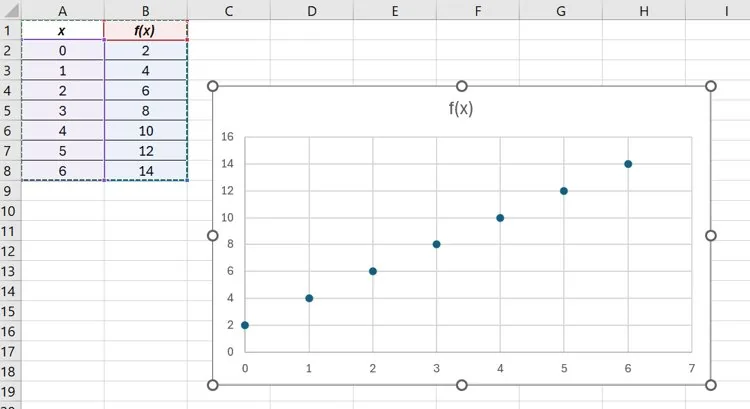
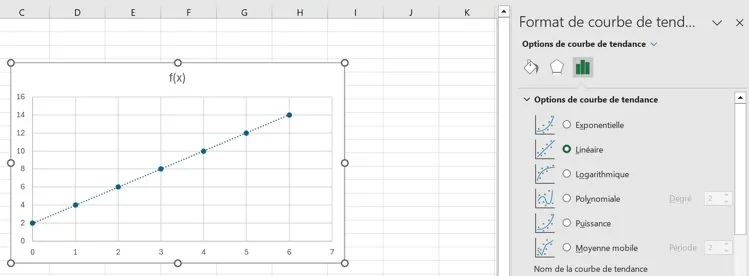
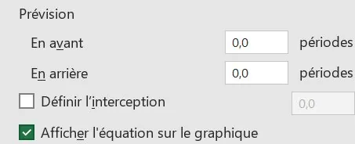

1.  **Entrer les données** : les valeurs de $x$ dans la colonne A, celles de $y$ dans la colonne B.

    

2.  **Afficher le nuage de points.**
    - Sélectionner avec la souris la plage contenant toutes les données (les cellules se grisent).

      

    - Aller dans « **Insertion** » puis choisir « **Nuage de points** », sans relier les points.

      

3.  **Afficher un modèle de régression.**
    - Faire un clic droit sur un des points du nuage.

      

    - Cliquer sur « **Ajouter une courbe de tendance** », puis choisir le modèle, par exemple « **Linéaire** ».

      

    - Cocher « **Afficher l'équation sur le graphique** » (et, si besoin, « Afficher le coefficient de détermination $R^2$ ») : l'équation s'affiche sur le graphique.

      

La même démarche en vidéo :

::: video fichiers/tableur-modelisation.mp4
:::
