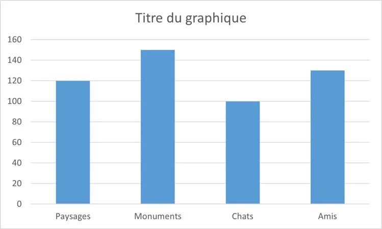
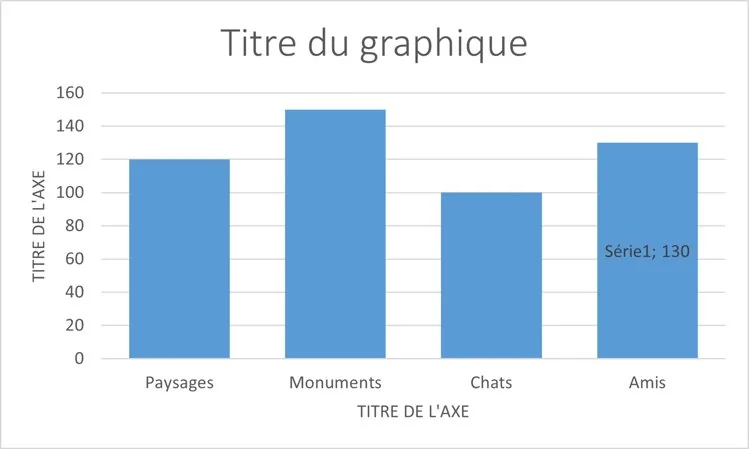

On veut ajouter un titre, nommer les axes, changer la disposition…

1.  Cliquer sur le graphique, puis **sélectionner « Disposition rapide »** et choisir les éléments à afficher (titre, titres des axes…).

    

2.  **Cliquer sur chaque titre** pour le modifier.

    

    
